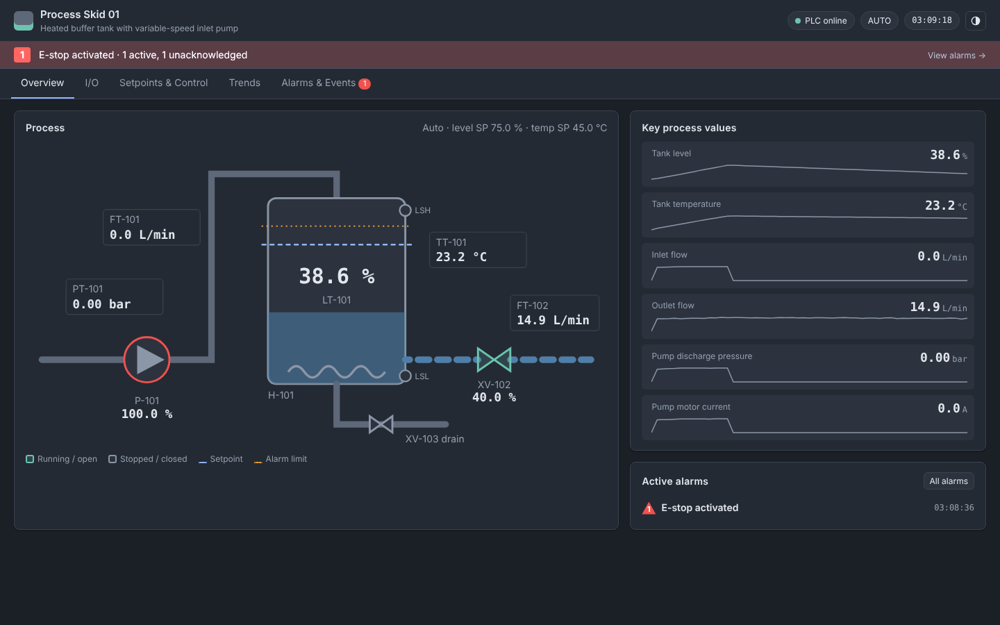

# Plant HMI – cloud portal + edge devices

Two apps in one codebase:

- **Cloud portal** (`src/cloud`) – your staff set up clients, sites, IoT2050
  devices, assets, PLC connections, I/O and users, then publish a versioned
  configuration package to each device.
- **Edge HMI** (`src/hmi`) – runs on each site gateway (e.g. a Siemens
  IoT2050). It reads the PLC, runs alarms, keeps recent trends and serves the
  operator UI on the local network, so authorised people can use it with **no
  internet connection**. It only ever holds its own client's data.

Today packages move from portal to device as a file (download → load on the
device). The next step links them: device enrolment, automatic config sync,
uploading data and on-site changes, and remote viewing.

## Cloud portal

```bash
python -m src.cloud                  # http://127.0.0.1:8100 (prints a one-time admin password)
```

Data lives in `data/cloud.db` (`--db` to change; git-ignored). Workflow:

1. **Clients** → *New client* (contact details).
2. On the client: **Add site** (address, time zone, days of trend history kept on the device),
   **Add device** for each IoT2050 (name, serial, site).
3. On the site: **Add asset** and pick the device it runs on. One device can run several
   assets; a site can have several devices. **Duplicate** copies an asset with all its I/O.
4. On the asset: set the **PLC connection** and define the **I/O** – add points in the
   same editor the device uses, or **Import CSV** (*merge* or *replace*; the whole file is
   checked first and nothing changes if any row is wrong). **CSV template** shows the columns;
   **Export CSV** gives the current list.
5. On the client: **Add user** for the client's people and set their **site access**
   (viewer / operator / engineer per site). They get a temporary password and choose their
   own the first time they sign in on site.
6. On the device: the checklist shows what's missing; **Publish new version** (with a note)
   once it's ready. Any later change flags the device as having unpublished changes.
   **Download** a version and load it on the IoT2050 (Commissioning → *Load package…*, or
   `python -m src.hmi --package file.json` on first start).

Staff accounts (**Staff** page, admins only) sign in to the portal and are included in
every package as **integrators**, so your technicians can commission and recover any
device. Every portal change is recorded in the **Activity log**.

I/O CSV columns: `name, description, kind (DI/DO/AI/AO/SP), type (bool/float), unit, min,
max, decimals, writable (yes), role, modbus_table (coil/discrete/input/holding),
modbus_address, modbus_scale, modbus_type, modbus_word_order, modbus_bit, s7_address,
s7_type, s7_scale, alarm_state (on/off), alarm_priority, alarm_message, alarm_hihi,
alarm_hi, alarm_lo, alarm_lolo, alarm_deadband, manual_only`. Comma, semicolon or tab
separated; Excel's UTF-8 or Windows encodings both work.

**Siemens PLCs:** on the asset, *Import TIA tags…* takes a PLC tag table exported from
TIA Portal (PLC tags → open the table → Export, .xlsx). Each tag becomes an S7 point with
its address and type; the kind (DI/DO/AI/AO/SP) is guessed from the address and *Hmi
Writeable*. Strings, times and structures are skipped with a reason. *Merge* keeps the
ranges, units and alarms you've already set for existing points.

**Auto/Manual:** on the asset, choose the digital point that is ON while the PLC runs in
Auto. Points marked *manual-only* are locked for operators while it's on.

# Edge HMI

- **Overview** – live process mimic, or an automatic status overview for any asset, with key values, sparklines and active alarms.
- **I/O** – every digital and analog point with state lamps, range bars and alarm-limit markers; toggle writable outputs.
- **Setpoints & Control** – Auto/Manual and setpoint changes with range validation and a confirm step.
- **Trends** – multi-pen trends from 1 minute to 7 days (recent data in the browser, older from the device database).
- **Alarms & Events** – ISA-18.2 style alarms with acknowledge, and a journal of every alarm, operator action, configuration change, sign-in and system event.
- **Commissioning** – device & package info, PLC connection test, I/O checkout with sign-off and report, on-site I/O edits.
- **Users** – accounts and roles for this site.



## Run it

**On an IoT2050:** use the installer – it sets the app up as a Linux service
that starts on boot. See [deploy/iot2050/README.md](deploy/iot2050/README.md).

**On a PC, for development or a demo:**

```bash
pip install -r requirements.txt
python -m src.hmi --demo                   # first start with the simulated demo plant
python -m src.hmi                          # first start unconfigured: load a package in the browser
python -m src.hmi --package site.json      # first start from your own configuration package
python -m src.hmi --host 0.0.0.0           # serve the local plant network
```

Then browse to http://127.0.0.1:8000. On first start the server prints a
one-time password for an `admin` **integrator** account. A new device with no
package shows a setup screen where an integrator loads one. Python 3.9 or newer.

Everything the device needs lives in one SQLite file, `data/edge.db`
(`--db` to change; git-ignored): client/site/device identity, assets, PLC
connections, I/O, users, recent trend history (`settings.history_days`,
default 7), the event journal, I/O check results, and a log of changes made
on site waiting to sync to the cloud. A package is only loaded when the
database is empty; after that, change things in the UI or load a new package
from the Commissioning tab.

## Workflow

**Offsite (today: a package file; later: the cloud portal)** – describe the
client, site, device and each asset with its PLC connection and I/O in a
configuration package, and load it on the gateway.

**Onsite (Commissioning tab)**

1. **PLC connection** – enter or confirm the PLC's IP, port, unit ID and poll rate and press **Test connection**: it opens a separate connection and reads every point once, reporting what it read and any errors. Integrators then **Save & apply**; the asset reconnects without restarting the server.
2. **I/O check** – force or simulate each signal at the PLC, watch the live value, and mark it **Pass**, **Fail** (with a note) or **N/A**. Each mark records who and when. Filter to what's left to check, and **Export report** for a CSV commissioning record.
3. **Fix on site** – integrators can edit a point (description, range, Modbus address/scale, alarms) or add/delete points. The change applies immediately, clears that point's check so it gets re-tested, and is kept in the **Local changes** log so the cloud can pick it up later.

## Configuration packages

```bash
python -m src.hmi.package demo site.json     # write the demo package to start from
python -m src.hmi.package import site.json   # apply one to data/edge.db
python -m src.hmi.package export backup.json # current configuration incl. on-site edits
```

A package holds `client`, `site`, `device` (each with an `id` and `name`),
`settings`, a list of `assets` – each with its `plc` connection
(`{"protocol": "modbus", "host": "192.168.1.10", "port": 502, "unit": 1, "poll_ms": 500}`
or `{"protocol": "sim"}`) and its `tags` – and optionally `users`. One gateway
can run several assets; give each a unique `id`. See `src/hmi/package.py` for
the full layout. Packages are validated before anything is changed.

Each tag has a kind (`DI`, `DO`, `AI`, `AO`, `SP`), type (`bool`/`float`),
units, engineering range, whether operators may write it, the minimum role
allowed to change it, optional alarms, and a PLC address for the asset's protocol:

```json
{"name": "AI_TankLevel", "kind": "AI", "type": "float", "unit": "%", "min": 0, "max": 100,
 "alarm": {"hi": "SP_LevelHiAlarm", "lo": 10, "deadband": 1},
 "modbus": {"table": "input", "address": 0, "type": "float32", "word_order": "big"},
 "s7": {"address": "%DB1.DBD4", "type": "real"}}
```

**Modbus TCP** (`"plc": {"protocol": "modbus", "host": ..., "port": 502, "unit": 1}`):
`table` is `coil`, `discrete`, `input` or `holding`; `type` is `int16` (default),
`uint16`, `int32`, `uint32` or `float32`; `word_order` `big` (ABCD, default) or `little`
(CDAB) for 32-bit values; `bit` 0–15 for a digital point inside a register (writes
change only that bit); `scale` divides the raw value. Reads are batched within the
protocol's limits, so addresses can be spread out.

**Siemens S7** (`"plc": {"protocol": "s7", "host": ..., "rack": 0, "slot": 1}` – S7-1200/1500
use rack 0 slot 1, S7-300 slot 2): TIA addresses `%I0.0 %Q0.1 %M10.3 %IW64 %QW2 %MD20
%DB1.DBX0.0 %DB1.DBW2 %DB1.DBD4` with `type` `byte/sint/usint`, `int/uint/word`,
`real/dint/udint/dword`. In TIA Portal allow *PUT/GET communication* in the CPU's
protection settings and turn off *Optimized block access* on DBs the HMI reads.

An asset's `mode_tag` names its Auto/Manual point (see the portal notes above).

**When the PLC stops answering**, values grey out with the time they were last
fresh, alarms and trends stop using the frozen values, and a *PLC communication
lost* alarm is raised after 10 s. Changing PLC settings never waits more than a
couple of seconds for an unreachable PLC.

**Time:** the HMI shows times in the site's time zone (from the package), whatever
the viewer's computer is set to. The Commissioning tab shows the device clock and
whether it's synchronised; a banner warns if it's more than two minutes out.

**HTTPS:** install with `--https` for a self-signed certificate (browsers ask you to
accept it once), or run `python -m src.hmi --tls-cert cert.pem --tls-key key.pem`.
Session cookies are then marked Secure.

## iPhone, iPad and other tablets

The interface adapts to phone and tablet screens: touch-sized controls, no
zoom-jumps when typing, tap-and-drag on trends, and card-style I/O checks on
phones. It needs iOS/iPadOS 16.2 or newer. In Safari, **Share → Add to Home
Screen** opens it full-screen like an app (with its own sign-in).

## Sign-in and roles

| Role | Can do |
|------|--------|
| Viewer | See every screen, trend and alarm. Read-only. |
| Operator | Change setpoints and outputs, switch Auto/Manual, acknowledge alarms. |
| Engineer | Everything above, plus tags marked `"role": "engineer"` (alarm limits, tuning), simulator inputs, PLC connection tests, I/O check sign-off and managing users up to engineer. |
| Integrator | Your commissioning technicians: everything, plus PLC connection settings, editing I/O on site, loading/downloading packages and managing integrator accounts. |

- New accounts and admin password resets get a temporary password; the user must replace it at their next sign-in.
- Sessions end after 30 minutes without interaction (`HMI_IDLE_MINUTES`, `0` disables), with a warning a minute beforehand.
- Five wrong passwords lock that username for a minute.
- Accounts live in the device database with scrypt password hashes; normally they'll arrive in the package from the cloud. Local account and password changes are logged for sync.
- Locked out? Manage accounts from the gateway's command line:

  ```bash
  python -m src.hmi.users list
  python -m src.hmi.users passwd admin
  python -m src.hmi.users add alice --role operator --name "Alice Smith"
  ```

## Architecture

```
browser ──WebSocket /ws/{asset}──▶ FastAPI ── SiteManager ──┬─ Runtime (asset 1: poll, alarms, trends) ── Driver ── PLC
        ──REST /api/*────────────▶            │             └─ Runtime (asset 2) ── Driver ── PLC
                                              └── Store (SQLite: config, users, history, journal, checks, change log)
```

REST, per asset under `/api/assets/{asset}/`: `config`, `state`, `history`,
`tags/{name}` (write), `simulate/{name}`, `alarms/ack`, `plc` (get/put),
`plc/test`, `io`, `io/{name}/check`, `tags/{name}/definition` (put/delete).
Device-wide: `/api/site`, `/api/package` (get/post), `/api/changes`,
`/api/login`, `/api/logout`, `/api/me`, `/api/me/password`, `/api/users`.

> **Security:** the session cookie is HttpOnly and SameSite=Strict, but the
> server itself speaks plain HTTP. When serving beyond localhost, put it behind
> HTTPS (a reverse proxy such as Caddy or nginx) and set `HMI_SECURE_COOKIES=1`
> so passwords and session cookies never cross the network unencrypted.

## Tests

```bash
python -m pytest tests --ignore=tests/e2e      # unit & API tests (Python 3.9+)
pip install playwright && python -m playwright install chromium
python -m pytest tests/e2e                     # browser walkthroughs of the HMI and portal
```

The browser tests start real edge and portal servers and drive them in Chromium:
live values, setpoints, alarms, Auto/Manual locks, commissioning, stale data, phone
layout, portal set-up → publish → load on a device, TIA import and a fresh device's
setup screen. Without a browser installed they're skipped.

GitHub Actions (`.github/workflows/ci.yml`) runs on every push: the unit tests on
Python 3.9, 3.11 and 3.12 (the IoT2050 images and current), the browser tests, and the
IoT2050 installer (shellcheck, an install, and an HTTPS start as the service account).

---

# Data Project Template

<a target="_blank" href="https://datalumina.com/">
    
</a>

## Cookiecutter Data Science
This project template is a simplified version of the [Cookiecutter Data Science](https://cookiecutter-data-science.drivendata.org) template, created to suit the needs of Datalumina and made available as a GitHub template.

## Adjusting .gitignore

Ensure you adjust the `.gitignore` file according to your project needs. For example, since this is a template, the `/data/` folder is commented out and data will not be exlucded from source control:

```plaintext
# exclude data from source control by default
# /data/
```

Typically, you want to exclude this folder if it contains either sensitive data that you do not want to add to version control or large files.

## Duplicating the .env File
To set up your environment variables, you need to duplicate the `.env.example` file and rename it to `.env`. You can do this manually or using the following terminal command:

```bash
cp .env.example .env # Linux, macOS, Git Bash, WSL
copy .env.example .env # Windows Command Prompt
```

This command creates a copy of `.env.example` and names it `.env`, allowing you to configure your environment variables specific to your setup.


## Project Organization

```
├── LICENSE            <- Open-source license if one is chosen
├── README.md          <- The top-level README for developers using this project
├── data
│   ├── external       <- Data from third party sources
│   ├── interim        <- Intermediate data that has been transformed
│   ├── processed      <- The final, canonical data sets for modeling
│   └── raw            <- The original, immutable data dump
│
├── models             <- Trained and serialized models, model predictions, or model summaries
│
├── notebooks          <- Jupyter notebooks. Naming convention is a number (for ordering),
│                         the creator's initials, and a short `-` delimited description, e.g.
│                         `1.0-jqp-initial-data-exploration`
│
├── references         <- Data dictionaries, manuals, and all other explanatory materials
│
├── reports            <- Generated analysis as HTML, PDF, LaTeX, etc.
│   └── figures        <- Generated graphics and figures to be used in reporting
│
├── requirements.txt   <- The requirements file for reproducing the analysis environment, e.g.
│                         generated with `pip freeze > requirements.txt`
│
└── src                         <- Source code for this project
    │
    ├── __init__.py             <- Makes src a Python module
    │
    ├── config.py               <- Store useful variables and configuration
    │
    ├── dataset.py              <- Scripts to download or generate data
    │
    ├── features.py             <- Code to create features for modeling
    │
    │    
    ├── modeling                
    │   ├── __init__.py 
    │   ├── predict.py          <- Code to run model inference with trained models          
    │   └── train.py            <- Code to train models
    │
    ├── plots.py                <- Code to create visualizations 
    │
    └── services                <- Service classes to connect with external platforms, tools, or APIs
        └── __init__.py 
```

--------